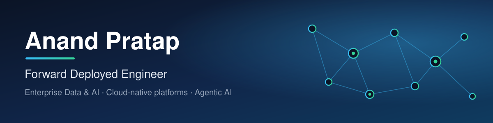

## About

Forward Deployed Engineer with 15+ years of experience designing and delivering large-scale, AI-powered data platforms across banking, healthcare and digital businesses. I work on the path from raw enterprise data to production AI: cloud data architecture, governance, and AI agents that automate real business workflows.

## What I do

**Cloud-native data architecture.** Scalable, cost-efficient platforms on Snowflake, Databricks, Azure and AWS, with a focus on performance optimization.

**AI-native automation.** Generative, conversational and agentic AI solutions built with LangChain, LangGraph and Snowflake Cortex AI, automating repetitive ETL, data transformation and business decision workflows.

**Real-time analytics and orchestration.** Python, SQL and cloud pipelines that feed real-time analytics and automated insight generation through AI agents, predictive models and conversational interfaces.

**Governance-led transformation.** Multi-million-dollar global data programs built on governance-driven architectures and Data Vault modeling, aligned to enterprise objectives and regulatory compliance.

**Machine learning and predictive analytics.** Models that improve accuracy and support near real-time decisions across banking, healthcare and digital domains.

## Tech stack

| Area | Tools |
| --- | --- |
| Data platforms | Snowflake, Databricks, Data Vault modeling |
| Cloud | Azure, AWS |
| AI and agents | Generative AI, Agentic AI, LangChain, LangGraph, Snowflake Cortex AI |
| Languages | Python, SQL |
| ML | scikit-learn, XGBoost, statsmodels, imbalanced-learn |
| BI and visualization | Power BI, matplotlib, seaborn |

## Hands-on projects on this profile

Public work here is hands-on Python, SQL and Power BI analysis, kept open so the methods can be read and reproduced.

| Project | What it shows | Stack |
| --- | --- | --- |
| [Credit card fraud detection](https://github.com/Anandpratap09/credit-card-fraud-detection) | Imbalanced classification on 284,807 transactions (492 fraud); seven model families compared; oversampling, threshold tuning and a cost-benefit analysis | Python, XGBoost, scikit-learn |
| [Lead scoring](https://github.com/Anandpratap09/Lead_Scoring_case_study) | Logistic regression lead score with cutoff selection and a precision/recall trade-off (ROC AUC 0.86) | Python, statsmodels |
| [Bike sharing demand](https://github.com/Anandpratap09/Bike-Sharing-Assignment) | Multiple linear regression with full residual diagnostics (test R² 0.80) | Python, statsmodels |
| [RSVP Movies analytics](https://github.com/Anandpratap09/RSVP-MOVIES-CASE-STUDY) | Business questions answered in SQL on the IMDb dataset | MySQL |
| [Credit card dashboard](https://github.com/Anandpratap09/Credit-Card-financial-dashboard) | Customer and transaction dashboards with the SQL behind them | Power BI, SQL |
| [Loan default EDA](https://github.com/Anandpratap09/EDA-Assignment) | Exploratory analysis of default drivers in loan application data | Python |

Client and employer work is confidential and not shown here.
